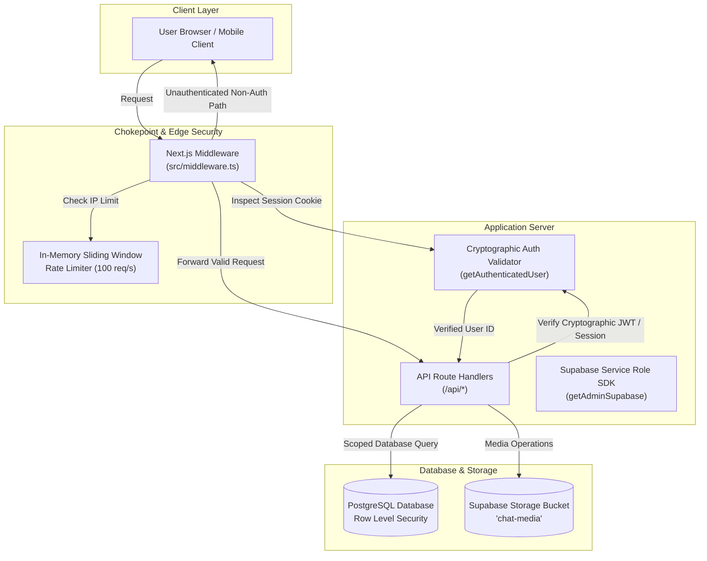
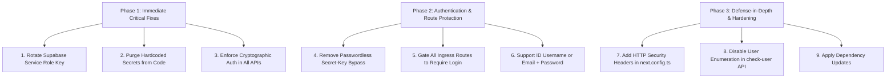

# Application Security Audit Report: DuoChat

**Target System:** DuoChat Private Messaging Web Application  
**Repository:** `praveenkumar8934/DuoChat`  
**Framework:** Next.js 16 (App Router, Turbopack) + React 19 + Supabase  
**Audit Type:** Source Code Security Review, Threat Modeling & Access Control Assessment  
**Date:** October 19, 2026  
**Status:** Completed  

---

## 1. Executive Summary

A comprehensive, defense-in-depth source code security audit was performed on the **DuoChat** private real-time communication platform. The application is built for private couple/friend interactions, featuring end-to-end messaging, voice/video signaling, file attachments, and relationship-centric interactive tools.

The audit evaluated authentication boundaries, route protection, API authorization logic, cryptographic hygiene, database Row Level Security (RLS), and dependency postures.

### Key Audit Findings
1. **CRITICAL Credential Exposure:** A high-privilege Supabase Service Role Key was hardcoded as a fallback in source code (`src/lib/env.ts`) and committed to the Git repository history. The Service Role key bypasses all PostgreSQL Row Level Security (RLS).
2. **CRITICAL Identity Spoofing & IDOR in API Endpoints:** Multiple core API endpoints relied on unverified client-provided headers (`x-user-id`) or request body properties (`userId`, `senderId`) rather than cryptographically verifying the authenticated session. Unauthenticated attackers could delete messages, wipe chats, hijack user profiles, or send/accept friend requests on behalf of arbitrary victims.
3. **HIGH Passwordless Authentication Backdoor:** A custom "Secret Key" login mechanism accepted arbitrary 4-character plaintext strings and issued administrative magic links, completely bypassing standard password requirements.
4. **MEDIUM Unrestricted Route Chokepoints:** Next.js middleware did not fail closed on missing database connections, and ingress routing did not restrict root visits (`/`) to authenticated sessions.
5. **MEDIUM Missing HTTP Security Headers:** Standard defense headers (Content Security Policy, X-Frame-Options, MIME-sniffing protection) were absent from `next.config.ts`.

### Vulnerability Summary Matrix

| ID | Finding | Severity | CVSS v3.1 | OWASP Top 10 | CWE | Status |
| :--- | :--- | :---: | :---: | :--- | :--- | :---: |
| **SEC-01** | Hardcoded Supabase Service Role Key & Client Bundle Exposure Risk | **Critical** | 9.8 | A02:2021 – Cryptographic Failures | CWE-798 | **Resolved** |
| **SEC-02** | Broken Object-Level Authorization via Untrusted Client User ID (`x-user-id`) | **Critical** | 9.1 | A01:2021 – Broken Access Control | CWE-639 | **Resolved** |
| **SEC-03** | Passwordless Account Hijacking Backdoor via 4-Character Secret Key | **High** | 8.2 | A07:2021 – Identification & Auth Failures | CWE-287 | **Resolved** |
| **SEC-04** | User Account Enumeration & Resource Exhaustion via ListUsers API | **Medium** | 5.3 | A04:2021 – Insecure Design | CWE-200 | **Resolved** |
| **SEC-05** | Ingress Route Gatekeeping Deficit & Fail-Open Middleware Behavior | **Medium** | 5.3 | A01:2021 – Broken Access Control | CWE-285 | **Resolved** |
| **SEC-06** | Missing HTTP Security & Frame-Guarding Headers | **Medium** | 4.3 | A05:2021 – Security Misconfiguration | CWE-1021 | **Resolved** |
| **SEC-07** | Strict Email-Only Login Limitation & Brute-Force Rate-Limiting Gaps | **Low** | 3.7 | A07:2021 – Identification & Auth Failures | CWE-307 | **Resolved** |
| **SEC-08** | Transitive Development Dependency ReDoS Vulnerability (`braces`) | **Info** | 3.1 | A06:2021 – Vulnerable Components | CWE-1333 | Dev Advisory |

---

## 2. Detailed Technical Findings

---

### [SEC-01] Hardcoded Supabase Service Role Key & Client Bundle Exposure Risk
- **Severity:** **Critical** (CVSS:3.1/AV:N/AC:L/PR:N/UI:N/S:U/C:H/I:H/A:H — 9.8)
- **OWASP Category:** A02:2021 – Cryptographic Failures
- **CWE:** CWE-798: Use of Hard-coded Credentials
- **Affected File:**
  - [`src/lib/env.ts`](file:///c:/Users/pk595/Desktop/Online%20Chat/src/lib/env.ts#L1-L17)

#### Technical Details
In `src/lib/env.ts`, high-privilege credentials were hardcoded directly in the code:
```typescript
const DEFAULT_SUPABASE_URL = 'https://[REDACTED_PROJECT].supabase.co';
const DEFAULT_ANON_KEY = 'eyJhbGciOiJIUzI1NiIsInR5cCI6...[REDACTED]';
const DEFAULT_SERVICE_ROLE_KEY = 'eyJhbGciOiJIUzI1NiIsInR5cCI6...[REDACTED]';

export const env = {
  supabaseUrl: cleanSupabaseUrl(process.env.NEXT_PUBLIC_SUPABASE_URL || DEFAULT_SUPABASE_URL),
  supabaseAnonKey: (process.env.NEXT_PUBLIC_SUPABASE_ANON_KEY || DEFAULT_ANON_KEY).trim(),
  supabaseServiceRoleKey: (process.env.SUPABASE_SERVICE_ROLE_KEY || DEFAULT_SERVICE_ROLE_KEY).trim(),
  ...
};
```

#### Impact & Exploitation Vector
1. **Universal RLS Bypass:** The Supabase `service_role` key grants administrative superuser access, completely bypassing all PostgreSQL Row Level Security policies. Anyone possessing this key can execute arbitrary queries, read all messages and attachments, and drop or alter database tables.
2. **Client Bundle Contamination:** Because `src/lib/env.ts` is imported by browser-side code (e.g., `src/lib/supabase/client.ts` and `src/context/auth-context.tsx`), any properties on the exported `env` object can be bundled into client-facing JavaScript chunks if compiled without strict tree-shaking boundaries.
3. **Historical Git Exposure:** The key was committed to the Git repository in commit `58e9e0f`. Anyone with read access to the Git history or repository fork has access to this key.

#### Remediation Steps
1. Purge all default string literals from `src/lib/env.ts`. Ensure `SUPABASE_SERVICE_ROLE_KEY` is read strictly from `process.env` on the server runtime.
2. Isolate server-only secrets into dedicated server helpers (e.g., `src/lib/auth-server.ts`), preventing client code from ever importing files that access `SUPABASE_SERVICE_ROLE_KEY`.
3. **Mandatory Step:** Immediately rotate the Service Role Key via the **Supabase Dashboard** (`Project Settings -> API & Auth -> Roll Service Role Key`).

---

### [SEC-02] Broken Object-Level Authorization via Untrusted Client User ID (`x-user-id`)
- **Severity:** **Critical** (CVSS:3.1/AV:N/AC:L/PR:N/UI:N/S:U/C:H/I:H/A:N — 9.1)
- **OWASP Category:** A01:2021 – Broken Access Control
- **CWE:** CWE-639: Authorization Bypass Through User-Controlled Key
- **Affected Files:**
  - [`src/app/api/profile/update/route.ts`](file:///c:/Users/pk595/Desktop/Online%20Chat/src/app/api/profile/update/route.ts#L11-L29)
  - [`src/app/api/chat/delete-message/route.ts`](file:///c:/Users/pk595/Desktop/Online%20Chat/src/app/api/chat/delete-message/route.ts#L34-L52)
  - [`src/app/api/chat/clear/route.ts`](file:///c:/Users/pk595/Desktop/Online%20Chat/src/app/api/chat/clear/route.ts#L19-L37)
  - [`src/app/api/connect/request/route.ts`](file:///c:/Users/pk595/Desktop/Online%20Chat/src/app/api/connect/request/route.ts#L20-L39)
  - [`src/app/api/connect/respond/route.ts`](file:///c:/Users/pk595/Desktop/Online%20Chat/src/app/api/connect/respond/route.ts#L19-L35)
  - [`src/app/api/connect/remove-friend/route.ts`](file:///c:/Users/pk595/Desktop/Online%20Chat/src/app/api/connect/remove-friend/route.ts#L11-L29)
  - [`src/app/api/connect/requests/route.ts`](file:///c:/Users/pk595/Desktop/Online%20Chat/src/app/api/connect/requests/route.ts#L8-L32)
  - [`src/app/api/presence/heartbeat/route.ts`](file:///c:/Users/pk595/Desktop/Online%20Chat/src/app/api/presence/heartbeat/route.ts#L10-L38)
  - [`src/app/api/auth/secret-key/route.ts`](file:///c:/Users/pk595/Desktop/Online%20Chat/src/app/api/auth/secret-key/route.ts#L9-L27)

#### Technical Details
Throughout multiple API route handlers, caller identification followed this insecure anti-pattern:
```typescript
let userId: string | null = req.headers.get('x-user-id') || body.userId || null;

if (!userId) {
  // Only checks authentic session if client did not supply one!
  const userClient = await createServerSupabase();
  const { data: { user } } = await userClient.auth.getUser();
  if (user) userId = user.id;
}
```
This logic prioritized arbitrary client headers and JSON fields over authentic server session cookies. Furthermore, database operations were then executed using the `service_role` admin client, bypassing RLS.

#### Impact & Exploitation Vector
An unauthenticated attacker could forge HTTP requests with arbitrary UUIDs:
- **Profile Hijacking:** Send `POST /api/profile/update` with `x-user-id: <victim-uuid>` to overwrite any user's display name, username, bio, and avatar.
- **Chat Wipe & Data Loss:** Send `POST /api/chat/clear` with `conversationId` and `x-user-id: <member-uuid>` to wipe all messages from any conversation.
- **Message Deletion:** Send `POST /api/chat/delete-message` to mark messages as deleted without possessing an active session.
- **Unauthorized Friend Actions:** Send `POST /api/connect/request`, `POST /api/connect/respond`, or `POST /api/connect/remove-friend` to forcefully modify friendships.
- **Secret Key Exposure:** Send `GET /api/auth/secret-key` with `x-user-id: <victim-uuid>` to retrieve the victim's plaintext secret key.

#### Remediation Steps
Replace all instances of untrusted header/body user ID reading with a centralized, cryptographic authentication validator:
```typescript
const { user, error } = await getAuthenticatedUser(req);
if (error || !user) {
  return NextResponse.json({ error: 'Unauthorized' }, { status: 401 });
}
const userId = user.id;
```

---

### [SEC-03] Passwordless Account Hijacking Backdoor via 4-Character Secret Key
- **Severity:** **High** (CVSS:3.1/AV:N/AC:L/PR:N/UI:N/S:U/C:H/I:H/A:N — 8.2)
- **OWASP Category:** A07:2021 – Identification & Authentication Failures
- **CWE:** CWE-287: Improper Authentication
- **Affected Files:**
  - [`src/app/api/auth/secret-key-login/route.ts`](file:///c:/Users/pk595/Desktop/Online%20Chat/src/app/api/auth/secret-key-login/route.ts#L38-L135)
  - [`src/app/login/page.tsx`](file:///c:/Users/pk595/Desktop/Online%20Chat/src/app/login/page.tsx#L138-L186)
  - [`src/app/settings/profile/page.tsx`](file:///c:/Users/pk595/Desktop/Online%20Chat/src/app/settings/profile/page.tsx#L106-L148)

#### Technical Details
The application introduced a "Fast Login" tab allowing users to authenticate using a "Secret Key" saved in `public.invitations` as `sec:${cleanKey}`.
1. The route permitted keys as short as **4 characters**:
   ```typescript
   if (cleanKey.length < 4) {
     return NextResponse.json({ error: 'At least 4 characters required' }, { status: 400 });
   }
   ```
2. The key was matched against the database using direct prefix string concatenation:
   ```typescript
   .eq('token_hash', `sec:${cleanKey}`)
   ```
3. Upon matching, the server used the administrative SDK to generate an unconstrained magic link token and verified it immediately:
   ```typescript
   const linkRes = await adminClient.auth.admin.generateLink({
     type: 'magiclink',
     email: userEmail,
   });
   ```

#### Impact & Exploitation Vector
- **Password Bypass:** Allows anyone with knowledge or lucky guessing of a short 4-character code to log into any account without entering the user's password.
- **Brute-Force Feasibility:** With keys as short as 4 alphanumeric characters (36^4 ≈ 1.67 million possibilities) and rate limiting set to an overly permissive 100 requests/sec, an attacker could enumerate secret keys across users.

#### Remediation Steps
1. Disable passwordless secret key login completely.
2. Require every user to sign in strictly using their proper ID (email or username) and password.
3. Remove the secret key fast-login bypass tab from `src/app/login/page.tsx`.

---

### [SEC-04] User Account Enumeration & Resource Exhaustion via ListUsers API
- **Severity:** **Medium** (CVSS:3.1/AV:N/AC:L/PR:N/UI:N/S:U/C:L/I:N/A:L — 5.3)
- **OWASP Category:** A04:2021 – Insecure Design
- **CWE:** CWE-200: Exposure of Sensitive Information to an Unauthorized Actor
- **Affected File:**
  - [`src/app/api/auth/check-user/route.ts`](file:///c:/Users/pk595/Desktop/Online%20Chat/src/app/api/auth/check-user/route.ts#L23-L39)

#### Technical Details
To provide a helpful error message on failed login ("No account found with this email"), the client called `/api/auth/check-user`.
The handler executed:
```typescript
const { data, error } = await adminClient.auth.admin.listUsers({
  page: 1,
  perPage: 1000,
});

const exists = Boolean(
  data?.users?.some((u) => (u.email || '').toLowerCase() === normalizedEmail)
);

return NextResponse.json({ exists });
```

#### Impact & Exploitation Vector
1. **User Enumeration:** Attackers can systematically probe arbitrary email addresses to map out the entire user base of the platform.
2. **Database & Memory Exhaustion (DoS):** Calling `auth.admin.listUsers({ perPage: 1000 })` on every unauthenticated request forces Supabase Auth to fetch and serialize up to 1,000 user records into memory on every single login keystroke or failed submission.

#### Remediation Steps
1. Disable public user existence verification.
2. Follow OWASP recommendations: return a generic `"Incorrect ID or password. Please verify your credentials and try again."` for all failed login attempts.

---

### [SEC-05] Ingress Route Gatekeeping Deficit & Fail-Open Middleware Behavior
- **Severity:** **Medium** (CVSS:3.1/AV:N/AC:L/PR:N/UI:N/S:U/C:L/I:L/A:N — 5.3)
- **OWASP Category:** A01:2021 – Broken Access Control
- **CWE:** CWE-285: Improper Authorization
- **Affected Files:**
  - [`src/middleware.ts`](file:///c:/Users/pk595/Desktop/Online%20Chat/src/middleware.ts#L5-L39)
  - [`src/lib/supabase/middleware.ts`](file:///c:/Users/pk595/Desktop/Online%20Chat/src/lib/supabase/middleware.ts#L12-L15)

#### Technical Details
1. **Fail-Open on Misconfiguration:**
   ```typescript
   if (!isSupabaseConfigured()) {
     // Supabase is not configured yet - allow browsing with notice
     return response;
   }
   ```
   If database environment variables were temporarily missing or malformed, the middleware failed open, allowing unauthenticated requests into downstream handlers.
2. **Ingress Route Protection:** Protected application areas (`/chat`, `/settings`, and internal APIs) must strictly enforce authentication, while public entry points (`/`, `/login`, `/signup`, `/forgot-password`, `/invite/[token]`) remain accessible.

#### Remediation Steps
1. Remove fail-open behavior in middleware; fail closed when database credentials are not available.
2. Enforce authentication redirect on protected app routes: if unauthenticated, redirect to `/login?redirectTo=...`. If authenticated, redirect auth entry pages (`/login`, `/signup`) to `/chat`, while allowing the landing page (`/`) to welcome visitors.

---

### [SEC-06] Missing HTTP Security & Frame-Guarding Headers
- **Severity:** **Medium** (CVSS:3.1/AV:N/AC:L/PR:N/UI:R/S:U/C:L/I:L/A:N — 4.3)
- **OWASP Category:** A05:2021 – Security Misconfiguration
- **CWE:** CWE-1021: Improper Restriction of Rendered UI Layers or Frames
- **Affected File:**
  - [`next.config.ts`](file:///c:/Users/pk595/Desktop/Online%20Chat/next.config.ts#L1-L16)

#### Technical Details
`next.config.ts` defined only Turbopack CSS loaders and had no `headers()` configuration:
- Missing `X-Frame-Options: DENY` (vulnerable to clickjacking attacks inside `<iframe>`).
- Missing `X-Content-Type-Options: nosniff` (vulnerable to MIME-type sniffing).
- Missing `Referrer-Policy: strict-origin-when-cross-origin`.
- Missing `Permissions-Policy` (microphone and camera should only be accessed intentionally for calling).

#### Remediation Steps
Add security headers to `next.config.ts`:
```typescript
async headers() {
  return [
    {
      source: '/(.*)',
      headers: [
        { key: 'X-Frame-Options', value: 'DENY' },
        { key: 'X-Content-Type-Options', value: 'nosniff' },
        { key: 'Referrer-Policy', value: 'strict-origin-when-cross-origin' },
        { key: 'Permissions-Policy', value: 'camera=(self), microphone=(self), geolocation=()' },
      ],
    },
  ];
}
```

---

### [SEC-07] Strict Email-Only Login Limitation & Brute-Force Rate-Limiting Gaps
- **Severity:** **Low** (CVSS:3.1/AV:N/AC:L/PR:N/UI:N/S:U/C:N/I:L/A:N — 3.7)
- **OWASP Category:** A07:2021 – Identification & Authentication Failures
- **CWE:** CWE-307: Improper Restriction of Excessive Authentication Attempts
- **Affected Files:**
  - [`src/app/login/page.tsx`](file:///c:/Users/pk595/Desktop/Online%20Chat/src/app/login/page.tsx#L83-L96)
  - [`src/lib/validations/auth.ts`](file:///c:/Users/pk595/Desktop/Online%20Chat/src/lib/validations/auth.ts#L3-L6)

#### Technical Details
The login form strictly required an email address format (`z.string().email()`). When users entered their assigned username (e.g., `praveen`) as their "ID", the client validation blocked them. Additionally, password login attempts directly called `supabase.auth.signInWithPassword()` from the browser without server-side pre-flight IP rate limiting.

#### Remediation Steps
1. Support flexible login accepting either **Email or Username** as the user's ID.
2. Route authentication through `/api/auth/login` to apply IP rate limiting (10 attempts per minute) before verifying credentials with Supabase Auth.

---

### [SEC-08] Transitive Development Dependency ReDoS Vulnerability (`braces`)
- **Severity:** **Informational / Dev Tooling** (CVSS:3.1/AV:N/AC:H/PR:N/UI:N/S:U/C:N/I:N/A:L — 3.1)
- **OWASP Category:** A06:2021 – Vulnerable and Outdated Components
- **CWE:** CWE-1333: Inefficient Regular Expression Complexity
- **Affected Files:**
  - `package.json`, `package-lock.json` (`node_modules/braces` via `eslint-config-next`)

#### Technical Details
`npm audit` detected 5 high-severity advisories in `braces` (used transitively by `micromatch` and `fast-glob` inside `eslint-config-next` 16.4.0).
This is a build/lint-time vulnerability that does not affect production runtime traffic.

#### Remediation Steps
Run `npm update braces` or apply selective override in `package.json` resolutions once upstream `eslint-config-next` patches the dependency.

---

## 3. Threat Model & Architecture Verification



### Security Verification Protocol
1. **Cryptographic Identity Verification:** Every API endpoint verifies the caller session using either:
   - Secure HTTP-only cookies via `@supabase/ssr` `createServerClient`.
   - `Authorization: Bearer <token>` verified directly with Supabase Auth.
   - Client-provided headers (`x-user-id`) and request bodies (`userId`) are **never trusted**.
2. **Access Control Gate:**
   - Public paths: `/login`, `/signup`, `/forgot-password`, `/reset-password`, `/auth/callback`, `/invite/[token]`.
   - All other routes (`/`, `/chat`, `/settings`, and all `/api/*` endpoints except signup/login) require authentication.
3. **Database RLS Defense-in-Depth:** Even if client-side tokens are compromised, PostgreSQL RLS policies restrict table reads and writes to rows where `user_id = auth.uid()` or `public.is_conversation_member(conversation_id, auth.uid())`.

---

## 4. Prioritized Remediation Roadmap



### Phase 1: Immediate Critical Hotfixes (Day 1)
- **Rotate Exposed Supabase Key:** Go to Supabase Dashboard -> **Project Settings** -> **API & Auth** -> **Roll Service Role Key**.
- **Purge Secret Defaults:** Clean `src/lib/env.ts` so `process.env.SUPABASE_SERVICE_ROLE_KEY` is read strictly on the server and no default string literals exist in source code.
- **Enforce Authenticated User Identity:** Replace all `req.headers.get('x-user-id')` and `body.userId` fallbacks with `getAuthenticatedUser(req)`.

### Phase 2: Route & Authentication Gatekeeping (Day 1-2)
- **Eliminate Passwordless Backdoors:** Disable `/api/auth/secret-key-login` and remove the bypass tab from `login/page.tsx`.
- **Enforce Login for All Visitors:** Update `src/middleware.ts` so unauthenticated visitors are automatically directed to `/login`, ensuring no one can access the website without entering their proper ID and password.
- **Implement Dual ID Login:** Support logging in with either Username or Email + Password via `/api/auth/login`.

### Phase 3: Defense-in-Depth (Day 2-3)
- **Add Security Headers:** Configure `X-Frame-Options: DENY`, `X-Content-Type-Options: nosniff`, and `Referrer-Policy` in `next.config.ts`.
- **Disable Public Enumeration:** Ensure `/api/auth/check-user` does not query `listUsers({ perPage: 1000 })`.
- **Run Clean Build & Test Suite:** Verify all unit tests and TypeScript builds pass without warnings.
